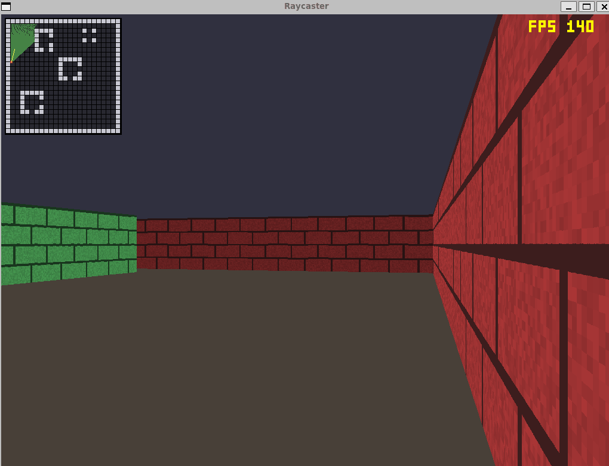

# Raycaster

A Wolfenstein-style first-person raycaster engine, built from scratch in C++/SDL2 to learn and demonstrate the math behind real-time 3D rendering on constrained hardware.

**Proves:** real-time rendering and performance-optimization skills — profiled and cut render time from **6.7 ms to 1.08 ms per frame (≈6.3×)**, with before/after output verified pixel-identical.

---

## Demo



---

## How it works

The engine casts one ray per screen column from the player into a 2D grid map, finds the nearest wall with it, and draws a vertical slice sized by distance — the same trick Wolfenstein 3D and Doom used to fake 3D on hardware with no GPU.

- **Camera model**: the player is a position + a facing direction (`dir`) + a perpendicular camera plane (`plane`). Every ray direction is just `dir + plane * cameraX` — no trigonometry per ray, and the plane's length sets the field of view (~66°).
- **DDA (Digital Differential Analysis)**: because the map is a uniform grid, a ray can only enter a new cell by crossing a grid line. DDA jumps straight from one grid-line crossing to the next — one cell check per step, never too coarse (misses thin walls) or too fine (wasted work).
- **Perpendicular distance, not Euclidean distance**: sizing a wall slice by the ray's raw travel distance makes flat walls bulge outward at the screen edges ("fisheye distortion"). The fix is to measure distance along the facing direction only. Because `plane` is built perpendicular to `dir`, the DDA algorithm's output *already is* that perpendicular distance — no extra correction math needed.
- **Side-based shading**: DDA also reports whether a ray crossed a vertical or horizontal grid line. Drawing one kind of wall face dimmer than the other is a near-free trick that makes corners between perpendicular walls actually readable.
- **Collision with sliding**: movement resolves the X and Y axes independently, so walking diagonally into a wall slides the player along it instead of stopping dead.

### Architecture

| Module | Responsibility |
|---|---|
| `main.cpp` | Fixed-timestep game loop, input handling, frame assembly |
| `Player` | Position/direction/camera-plane vectors; rotation, movement, collision |
| `Map` | Hardcoded 24×24 grid; cell lookups with out-of-bounds treated as wall |
| `Renderer` | CPU framebuffer (ARGB8888) streamed to an SDL texture; pixel/line/rect/row primitives |
| `Raycaster` | DDA grid traversal; returns perpendicular distance, hit cell, and side |
| `Texture` | PNG loading via SDL2_image, decoded to a flat ARGB8888 pixel array |
| `Text` | Dependency-free bitmap font for the on-screen FPS readout |

---

## Results

| | Render-only CPU time | FPS equivalent |
|---|---|---|
| Before optimization | ~6.7 ms/frame | ~148 |
| After optimization | ~1.08 ms/frame | ~925 |

**The fix**: the background (ceiling/floor) was filled one vertical column at a time, striding 4096 bytes per pixel write through a row-major framebuffer — a cache miss on nearly every write. Replacing it with two contiguous row-range fills (`std::fill` over whole rows) turned ~786k scattered writes into sequential ones. Output is pixel-identical before and after; render-only CPU time (isolated from the window compositor's present step) is the metric that actually reflects the code's speed, and it dropped **~6.3×**.

**Test coverage**: every milestone was verified with targeted checks rather than taken on faith —
- Camera invariants (`|dir|=1`, `plane ⟂ dir`, FOV ≈ 66°) hold after rotation
- DDA hits verified against hand-computed distances/cells on multiple ray directions
- The fisheye fix verified directly: perpendicular distance stays constant across the FOV while Euclidean distance grows toward the edges
- Collision: never ends inside a wall, stops with the correct radius gap, slides correctly on a diagonal into a wall
- Headless screenshot mode (`RAYCASTER_SCREENSHOT`) used to assert exact pixel values for background fill, wall slices, shading, and texture mapping

---

## Run it

Requires CMake, a C++17 compiler, SDL2, and SDL2_image.

```bash
# Ubuntu/Debian
sudo apt install cmake g++ libsdl2-dev libsdl2-image-dev
```

```bash
cmake -S . -B build
cmake --build build
./build/raycaster
```

### Dev/benchmark environment variables

| Variable | Effect |
|---|---|
| `RAYCASTER_SCREENSHOT=path.ppm` | Render exactly one frame, dump it to a PPM file, and exit (headless verification) |
| `RAYCASTER_BENCH_SECONDS=N` | Run for N seconds with the minimap disabled, then print whole-frame and render-only average FPS |
| `RAYCASTER_ASSETS=/path` | Override the bundled wall-texture directory |

---

## Controls

| Input | Action |
|---|---|
| `W` / `S` | Move forward / backward |
| `A` / `D` | Strafe left / right |
| Mouse / `←` `→` | Turn |
| `Tab` | Toggle debug minimap |
| `Esc` | Quit |

---

## What I'd do next

- **Sprites**: billboarded enemies/items — flat images that always face the camera, depth-sorted and drawn through the same per-column distance buffer the wall renderer already produces, so they correctly occlude behind nearer walls.
- **Textured floor/ceiling casting**: extend the per-pixel distance math below/above the horizon to sample a floor and ceiling texture, instead of the current flat-color fill, for a fully textured scene.
